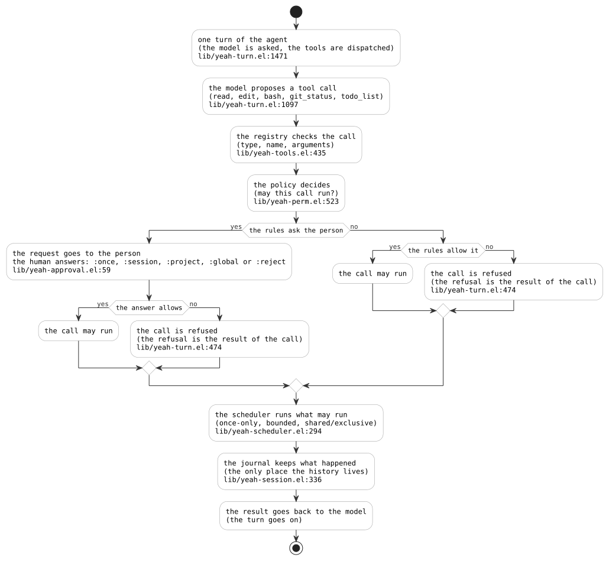
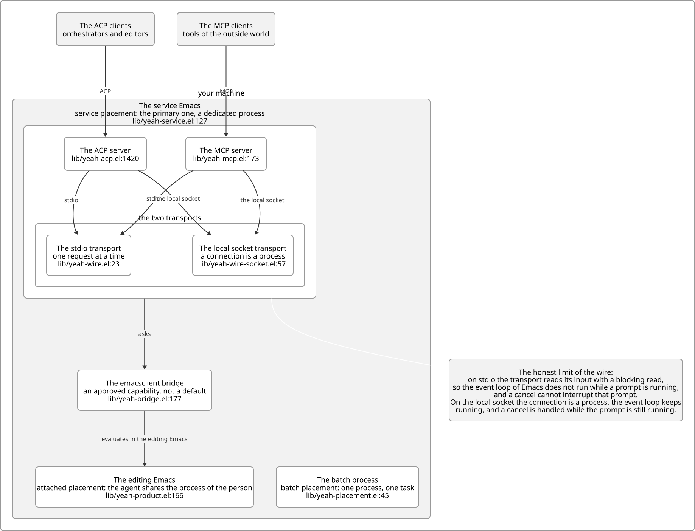
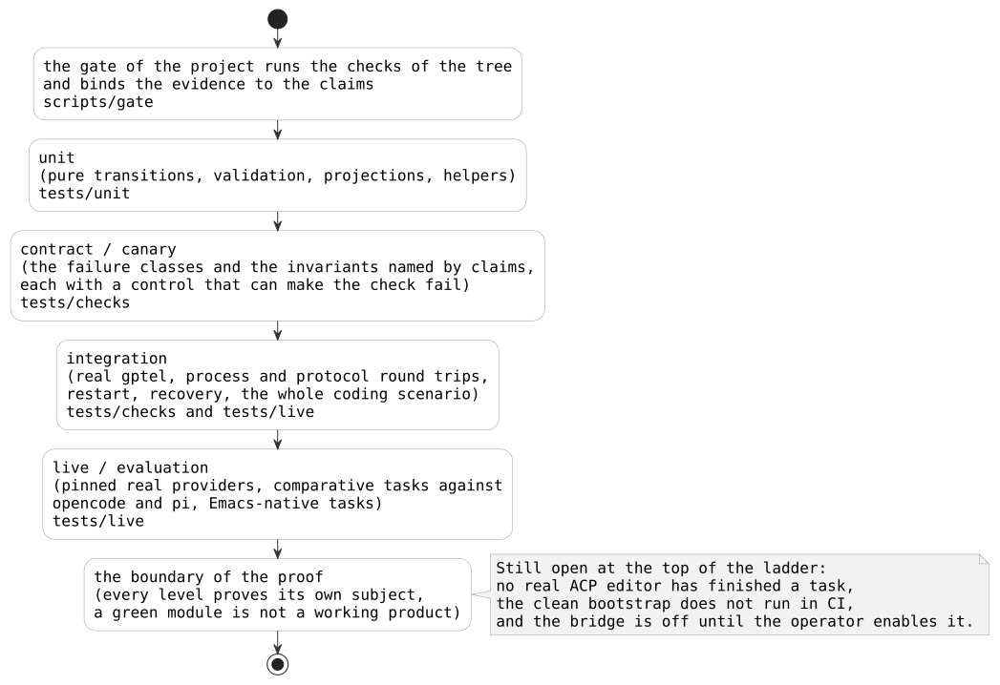

# Yeah — Emacs Agent Harness

**Yeah** is an agent harness written in Emacs Lisp. The agent runs *inside*
Emacs instead of beside it: the model is reached through
[gptel](https://github.com/karthink/gptel), every effect is a permissioned
Elisp function, and the history of a session is an append-only JSONL journal.

> **Status: v0.3.0 — a kernel, not a finished product.** The tools work, the
> wire speaks ACP and MCP, and a live model completes a coding task through
> the harness. What works and what is still open is written down in
> [`docs/STATUS.md`](docs/STATUS.md). The machine-checked truth is
> `spec.json`, read with `./scripts/dev map`.

Yeah means Yeah, Emacs Agent Harness — a recursive acronym. The Y is the
Y-combinator, and it names the shape the project aims at: bounded delegation,
runtime self-inspection, and a fixed point at which Yeah can develop and
verify Yeah itself.

The website is <https://11111000000.github.io/yeah/>: the frame of Emacs
30.2, with the diagrams of the architecture.

## Why Emacs

Emacs is not an API surface; it is an environment people have invested
themselves in. Decades of community packages, a configuration sharpened for
years, workflows fitted to their hands. An agent that starts from nothing has
to rebuild all of that before it can help.

Yeah starts from it instead. The harness reaches the live buffers of the
person, including the unsaved ones; the documentation and the introspection
of the system it lives in; the diagnostics of the LSP the person configured;
and the undo of Emacs, which is the undo of the editor itself.

The reasoning is in [`docs/VISION.md`](docs/VISION.md), in Russian in
[`docs/VISION.ru.md`](docs/VISION.ru.md).

## How it works

One turn: the model proposes a call, the registry and the policy decide, the
journal remembers.

<picture>
  <source media="(prefers-color-scheme: dark)" srcset="site/assets/diagrams/one-turn-dark.svg">
  
</picture>

Three commitments hold the kernel together:

- **Elisp is the kernel.** The run controller, the typed tool registry, the
  permission policy and the journal live in `lib/`. There is no second
  implementation of the agent in another language.
- **Every effect has a policy.** A call of the model passes the validation of
  its arguments and the last matching permission rule. A read that changes
  nothing is answered by the harness itself and says why; the answer
  `always` becomes a rule, so the same question is not asked twice. Plan and
  Build are profiles of one engine, not two engines.
- **The journal is the truth.** The context, the state of the interface, the
  approvals and the recovery are projections of append-only events.
  Compaction adds events; it does not erase history.

The normative description of the design is
[`docs/ARCHITECTURE.md`](docs/ARCHITECTURE.md).

## Where it runs

<picture>
  <source media="(prefers-color-scheme: dark)" srcset="site/assets/diagrams/placements-dark.svg">
  
</picture>

| Placement | The process | What it is for |
|---|---|---|
| **Service** (the primary one) | a dedicated Emacs owns the harness; the editor reaches it through the explicitly approved emacsclient bridge; clients and orchestrators speak ACP or MCP | long turns that must not block the editing Emacs, which is single-threaded |
| **Attached** | the harness inside the person's own Emacs (`M-x yeah-attached`) | demos, development, light tasks, and the fallback when the service cannot start |
| **Batch** | one headless process, one task | scripted checks and measurements |

All three write the same events for the same task.

## Install

On Emacs 30.2 with `package-vc`:

```elisp
(require 'package-vc)
(package-vc-install
 '(yeah :url "https://github.com/11111000000/yeah.git" :lisp-dir "lib"))
```

Or from a clean Emacs, with gptel installed from MELPA as well:

```sh
emacs -Q --batch -l install/yeah-bootstrap.el
```

Then point gptel at a backend and a model through your own Emacs mechanism,
run `M-x yeah-doctor`, and start with `M-x yeah`.

## Status

<picture>
  <source media="(prefers-color-scheme: dark)" srcset="site/assets/diagrams/check-levels-dark.svg">
  
</picture>

- **Verified in this checkout:** the unit tests pass, the canaries pass with
  their controls, and every module of `lib/` byte-compiles without warnings.
  `./scripts/dev gate` is the verdict of the project, and it answers
  `unknown` today: one claim of the specification is a decision of the owner
  and not a fact that a check can establish.
- **Verified against a live provider:** a model completes the coding task,
  drives the interactive path (cancel, restart, resume, recovery of a pending
  input), and a delegated child repairs a Yeah canary.
- **Not verified:** a real editor against a live provider, the bridge in
  day-to-day use, and the parity with other harnesses — the last one is a
  measurement in progress and not a claim.

[`docs/STATUS.md`](docs/STATUS.md) holds the ledger: what works, what is
open, and the numbers with the command that measured them.

## Non-goals

Deliberately not built:

- a second kernel of the agent in another language;
- destructive compaction or a history of snapshots — the journal is
  append-only;
- unrestricted evaluation presented as safe: the evaluation of the project is
  experimental, off by default, and not a security boundary;
- the internals of gptel treated as architecture: the adapter is checked
  against the real contracts of gptel;
- telemetry, a lock-in to one provider, or a cloud-only operation;
- a parallel ecosystem of plugins that duplicates the registries.

## Documentation

| Document | What it holds |
|---|---|
| [`docs/VISION.md`](docs/VISION.md) | why the project exists, and what it refuses |
| [`docs/ARCHITECTURE.md`](docs/ARCHITECTURE.md) | the normative target: the decisions, the contracts, the security model, the non-goals |
| [`docs/STATUS.md`](docs/STATUS.md) | what works today, what is open, and the evidence |
| [`docs/PLAN.md`](docs/PLAN.md) | the stages, the gates, the open work and the decisions of the owner |
| [`docs/ENGINEERING.md`](docs/ENGINEERING.md) | how the project is built, tested and operated |
| [`docs/LIVE-EVIDENCE.md`](docs/LIVE-EVIDENCE.md) | the ledger of the runs against a real provider |
| [`docs/PASEO-INTEGRATION-PLAN.md`](docs/PASEO-INTEGRATION-PLAN.md) | the integration with the orchestrator Paseo |
| `spec.json`, `waves/` | the claims of the standing specification and the history of the work units |

The pictures of the architecture are drawn from `site/diagrams/`.

## Development

```sh
./scripts/dev help              # every subcommand
./scripts/dev byte-compile-all  # the kernel compiles without warnings
./scripts/dev ert tests/unit/*.el
./scripts/dev check tests/checks/*
./scripts/dev gate               # run the checks, bind the evidence, print the verdict
```

Emacs has to be on `PATH` (or in `EMACS`); the map and the gate also need a
`mathc` that can read the specification of the project. The checks against a
live provider need credentials in the environment and are not part of CI:
[`docs/ENGINEERING.md`](docs/ENGINEERING.md) §8.1 describes how to run them.

## Author

- **Petr Kosov** <p.b.kosov@yandex.ru>

## License

- **Apache-2.0** (see `LICENSE`, `NOTICE`)
